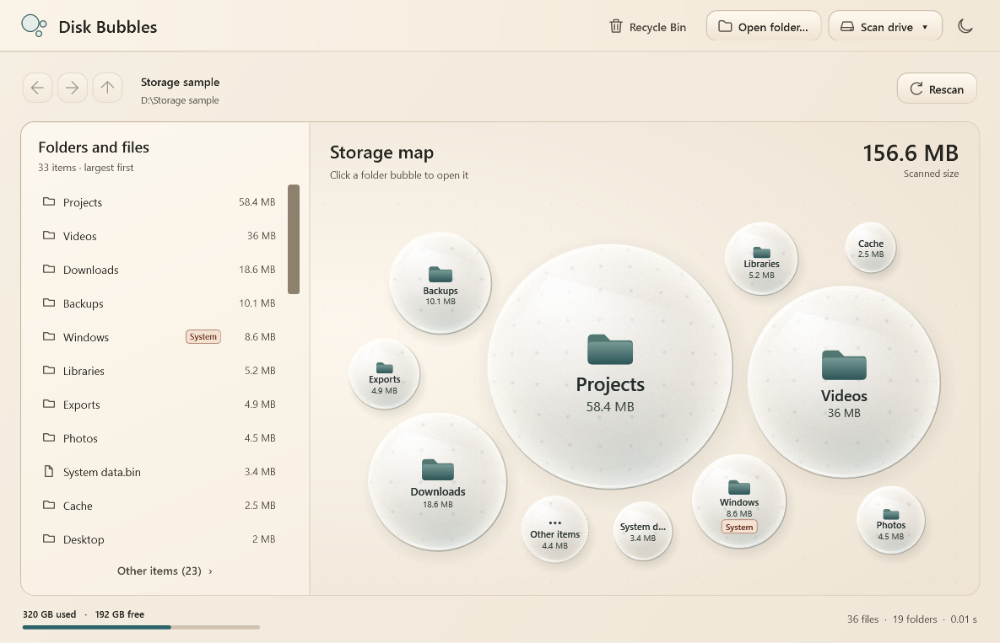

# Disk Bubbles

Disk Bubbles shows where your Windows storage went. Scan a drive or folder and get a map sized by the files inside it. The biggest folders are easy to spot, and a click takes you straight into one.

[Download for Windows](https://github.com/tiwaritarush/disk-bubbles/releases/tag/v10.0.1) · [Build from source](#build-from-source) · [Report an issue](https://github.com/tiwaritarush/disk-bubbles/issues)


Windows can tell you that a drive is nearly full. Figuring out which project, download, or backup is responsible often means opening one folder after another. Disk Bubbles puts the sizes and hierarchy in the same view so you can go straight to the folders worth investigating.

## What you can do

- **Scan a drive or folder.** See progress as Windows enumerates the files. You can cancel a scan and return to your previous results.
- **Explore by size.** Click a folder bubble to open it, or double-click the folder in the list. Hover for its size and share of the current folder. Back and Forward remember your scroll position and the **Other items** filter.
- **Review files before recycling.** Choose a few items and see what Windows can verify before you confirm. The app flags protected Windows locations and checks file identities again before asking the Shell to move anything.
- **Switch between light and dark.** The beige and graphite themes are included, and the app remembers your choice. Motion follows the Windows animation setting.



## Run it

Get `DiskBubbles.exe` from the [release page](https://github.com/tiwaritarush/disk-bubbles/releases/tag/v10.0.1) and run it on Windows 10 or 11 with .NET Framework 4.8 or later. It runs with your usual Windows permissions. The portable executable is unsigned, and the release includes a SHA-256 checksum for checking the download.

Start with **Scan C:** or **Choose folder**. In the file list, press **Enter** to open the selected folder. Use **Alt+Left**, **Alt+Right**, and **Alt+Up** to navigate. Select a file and choose **Show in File Explorer** to see it in context.

The map shows logical file sizes. The space a file takes up on disk can differ, especially for compressed, sparse, or hard-linked files. The capacity meter uses the space Windows reports for your account. Scan results stay in memory, and Disk Bubbles sends no telemetry.

## Build from source

Install the .NET SDK on Windows. From the repository root in PowerShell, run the following commands.

```powershell
.\Build.ps1
.\Verify.ps1
```

The build writes `artifacts/DiskBubbles.exe`. Verification runs against files it creates under `artifacts/verification/` and saves screenshots there. It exercises the UI and Recycle Bin safeguards using disposable fixtures. Release details and remaining validation gaps are in the [changelog](CHANGELOG.md).

## How it works

Disk Bubbles is written in **C#** with a **WPF and XAML** interface on **.NET Framework 4.8**. The scanner reads Windows directory records in batches and uses several workers to cover a volume. The map uses native WPF drawings, which are cached when you go back to a folder. The app has no external package dependencies.

See [the architecture notes](docs/architecture.md) for the scan and Recycle Bin boundaries. For patches and bug reports, see [Contributing](CONTRIBUTING.md). For a potential vulnerability, use the [security reporting instructions](SECURITY.md).

Disk Bubbles is available under the [MIT License](LICENSE).
