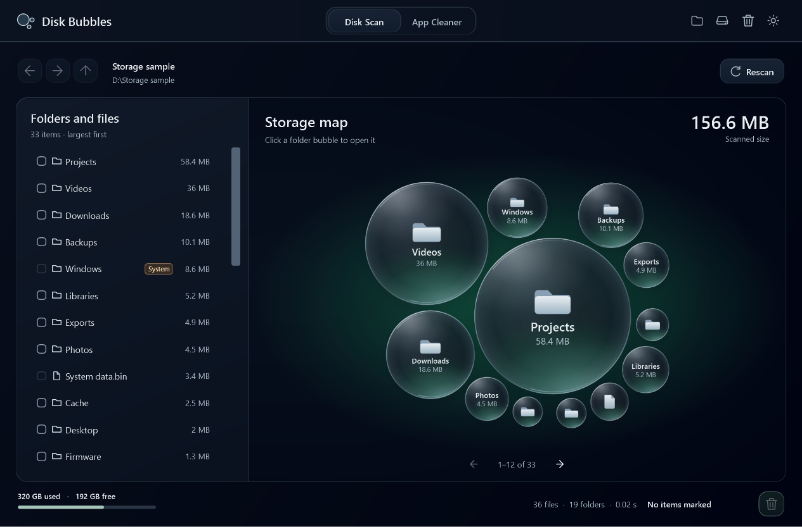
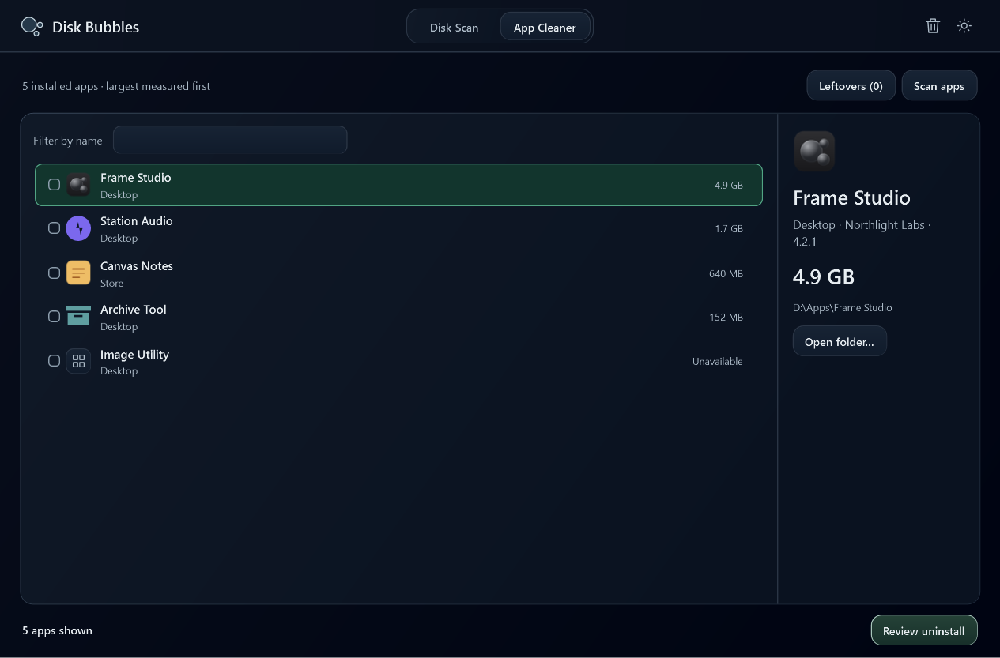

# Disk Bubbles

Disk Bubbles shows where your Windows storage went. Scan a drive or folder and get a map sized by the files inside it. The biggest folders are easy to spot, and a click takes you straight into one.

[Download for Windows](https://github.com/tiwaritarush/disk-bubbles/releases) · [Build from source](#build-from-source) · [Report an issue](https://github.com/tiwaritarush/disk-bubbles/issues)



Windows can tell you that a drive is nearly full. Figuring out which project, download, or backup is responsible often means opening one folder after another. Disk Bubbles puts the sizes and hierarchy in the same view so you can go straight to the folders worth investigating.

## What you can do

- **Scan a drive or folder.** See progress as Windows enumerates the files. You can cancel a scan and return to your previous results.
- **Explore by size.** Click a folder in the list or on the map to open it. Hover to see its size and share of the current folder. Use the map arrows to see smaller entries, including empty ones. Back and Forward remember your scroll position and map page.
- **Mark items as you browse.** Check files or folders anywhere in the scan. Use the trash icon at the bottom right to review everything together. The app protects critical Windows locations and verifies file identities before asking Windows to move anything.
- **Review installed apps.** App Cleaner shows scan progress, then lists desktop and Store apps with their registered icons and measured install sizes where available. Review uninstall actions or check for folders left after a desktop uninstall.
- **Switch between light and dark.** The glass sits over a soft pink blush in the cream theme and green in the midnight theme. The app remembers your choice and follows the Windows animation setting.




## Run it

Get `DiskBubbles.exe` from the [releases page](https://github.com/tiwaritarush/disk-bubbles/releases) and run it on Windows 10 or 11 with .NET Framework 4.8 or later. It runs with your usual Windows permissions. The portable executable is unsigned, and the release includes a SHA-256 checksum for checking the download.

Start with **Scan drive** or **Open folder**. Press **Enter** on a row to open its folder or reveal its file in File Explorer. Use **Alt+Left**, **Alt+Right**, and **Alt+Up** to navigate. A new scan starts a fresh set of marks.

The map shows logical file sizes. The space a file takes up on disk can differ, especially for compressed, sparse, or hard-linked files. The capacity meter uses the space Windows reports for your account. Scan results stay in memory, and Disk Bubbles sends no telemetry.

## Build from source

Install the .NET SDK on Windows. From the repository root in PowerShell, run the following commands.

```powershell
.\Build.ps1
.\Verify.ps1
```

The build writes `artifacts/DiskBubbles.exe`. Verification runs against files it creates under `artifacts/verification/` and saves screenshots there. It exercises the UI and Recycle Bin safeguards using disposable fixtures. Release details and remaining validation gaps are in the [changelog](CHANGELOG.md).

## How it works

Disk Bubbles is written in **C#** with a **WPF and XAML** interface on **.NET Framework 4.8**. The scanner reads Windows directory records in batches and uses several workers to cover a volume. The map uses native WPF drawings, which are cached when you go back to a folder. The app has no external package dependencies.

See [the architecture notes](docs/architecture.md) for the scan and Recycle Bin boundaries. For patches and bug reports, see [Contributing](CONTRIBUTING.md). For a potential vulnerability, use the [security reporting instructions](SECURITY.md).

Disk Bubbles is available under the [MIT License](LICENSE).
