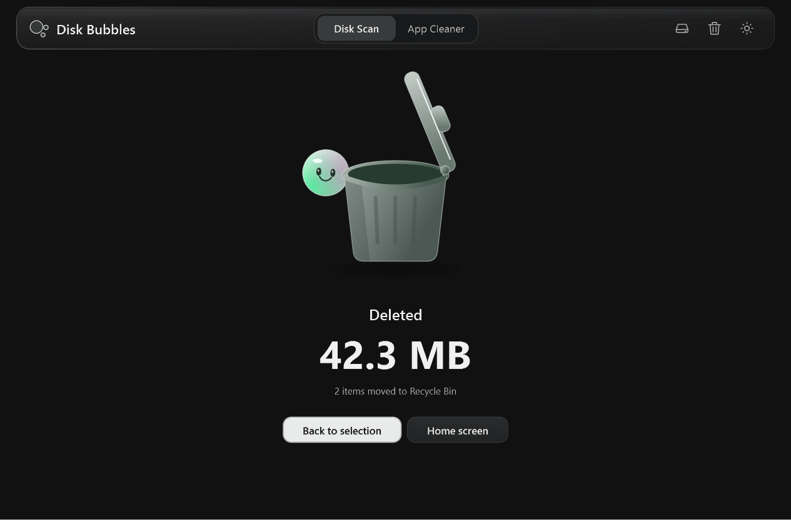

# Selection and deletion

Checkboxes select items for review. Their full column is a click target, and the model notifies the list when a context-menu action changes a mark. Selection is allowed for protected items so the checkbox always responds; deletion still checks protection and file identity. A protected item's Delete command is disabled, and the review explains why it must stay in place.

The last bubble hovered keeps its matching row highlighted. A different bubble replaces that highlight; changing folders clears it. Highlighting scrolls the matching row into view. It does not mark the item for deletion.

Bubble menus contain Select, Delete and Open in Explorer, in that order. Select marks and reveals the matching row. Delete validates only the clicked item and moves it to the Recycle Bin without requiring a checkbox or a separate selection review. The normal trash action still reviews cumulative marks. Both paths use the existing identity and protection checks.

## Review and move

Review collapses nested marks under a marked parent, then checks each item against the disk as it is now: the path must still name a plain local file or folder (no link or alias), the type must match the scan, a file's size must match, and its volume and file identity are recorded. Review never re-scans folder contents, so it is instant for folders of any size.

The move runs on its own STA thread. Just before it, each item's identity is read again; a file edited since review or a folder replaced by another of the same name stays put with "changed after review". The remaining items go to one [IFileOperation](https://learn.microsoft.com/en-us/windows/win32/api/shobjidl_core/nn-shobjidl_core-ifileoperation) with Recycle Bin semantics and a progress sink, the engine File Explorer uses. Windows reports each item through `PostDeleteItem`: a success with a new Recycle Bin item is moved to the Recycle Bin; a success without one is permanently deleted, which only happens after the user accepts the standard Windows prompt for an item too large for the Bin; a failure keeps the item and its copy-engine code from the SDK's `sherrors.h` becomes a plain reason, such as an app holding the file open. Anything Windows did not report is settled from the filesystem. The status line shows progress while Windows works; very large folders take Windows a moment because it examines every file first.

The completion page appears only when at least one item was removed. Its size and count come only from items Windows confirmed, and it says when any were permanently deleted. Moving to the Recycle Bin does not immediately free that space on the volume; the page names the destination rather than claiming free disk capacity. Items that stayed are listed with their reasons in the results dialog first.

Windows uses system attributes for [ordinary folder customization](https://learn.microsoft.com/en-us/windows/win32/shell/how-to-customize-folders-with-desktop-ini) as well as operating-system files. A customized user folder and its `desktop.ini` or `Thumbs.db` metadata do not block removal by themselves. Critical path rules, system-managed roots, other system-marked files, registered app locations and link checks still apply during scanning and final identity verification.

Explorer navigation resolves a filesystem path to a Shell item ID on a separate STA thread. A folder opens through `ShellExecuteEx`; a file is selected through [SHOpenFolderAndSelectItems](https://learn.microsoft.com/en-us/windows/win32/api/shlobj_core/nf-shlobj_core-shopenfolderandselectitems). The resolved filesystem path must match the requested one. Missing paths and changed item types produce an error rather than a Home window. App Cleaner uses the same folder-opening path.

## Completion motion

The large central scene is drawn with native WPF vectors. The bin falls under acceleration, compresses on impact and rebounds. Its attached lid springs to 75% of a right angle. A green and pink glass bubble with eyes and a smile enters from below, circles upward in front of and behind the bin, then bursts above the opening. Every particle follows a curve into the open mouth. The bin contracts into a point after the particles arrive.

The sequence lasts 4.6 seconds. The two navigation actions are available immediately; users do not have to wait for the animation. Rendering stops on completion, when the page is hidden, or when its window unloads. Windows reduced-motion settings replace the movement with a static scene.

Off-screen verification covers both themes, compact windows, key animation poses, selection bindings, sticky hover, protected commands, confirmed size totals and both completion actions. It also moves disposable fixture files and a folder to the Recycle Bin for real, holds one file open from another handle to confirm it stays with a clear reason, edits a file after review and replaces a folder after review.

